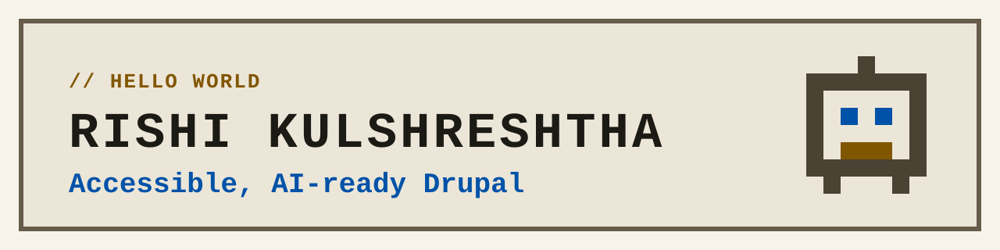

<picture>
  <source media="(prefers-color-scheme: dark)" srcset="assets/banner-dark.svg">
  
</picture>

I'm a Drupal developer and contributor in Portland, Maine. I build sites that work for every visitor and that AI agents can read accurately, and I share what I learn with the Drupal community.

## What I maintain

- [LLMs.txt Gen](https://www.drupal.org/project/llms_txt_gen): generates `llms.txt` for a Drupal site, so AI agents read the site as it is structured instead of guessing from scraped pages.
- [Hover Card](https://www.drupal.org/project/hover_card): shows user details when someone hovers over or focuses a username link.
- [SiteInfo](https://www.drupal.org/project/siteinfo): a quick overview of a Drupal site's key information.

I also contribute through the Drupal.org issue queues, security advisories, documentation, automated tests and mentoring.

## Accessibility

I do WCAG, Section 508 and ADA work for universities and public agencies: audits, remediation, and building it in from the start so it does not need fixing later. My own site publishes an [accessibility statement](https://rishikulshreshtha.github.io/accessibility-statement) and I hold it to the same standard I apply to client work.

## AI-readiness

I work on making websites legible to AI agents without giving up control of the content. That includes `llms.txt`, structured Markdown versions of pages, and practical questions about cost and governance when AI features go into a Drupal site. You can see a working example in my site's own [llms.txt file](https://rishikulshreshtha.github.io/llms.txt).

## Writing and talks

- [NEDCamp 2026: AI talks on cost and control in Drupal](https://rishikulshreshtha.github.io/writing/nedcamp-2026-ai-cost-control)
- [All writing](https://rishikulshreshtha.github.io/writing), also available as an [RSS feed](https://rishikulshreshtha.github.io/rss.xml)
- [Talks](https://rishikulshreshtha.github.io/talks)

## Find me

- [Drupal.org profile](https://www.drupal.org/u/rishikulshreshtha)
- [Drupal GitLab profile](https://git.drupalcode.org/RishiKulshreshtha)
- [Personal site](https://rishikulshreshtha.github.io)
- [LinkedIn](https://www.linkedin.com/in/rishikulshreshtha/)

---

This profile uses real headings, alt text and no motion. If something here is hard to use, please [open an issue](https://github.com/RishiKulshreshtha/RishiKulshreshtha/issues).
